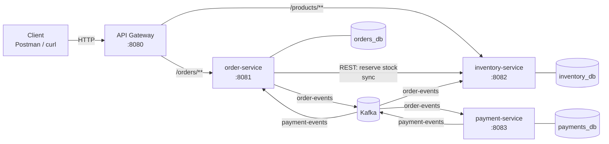
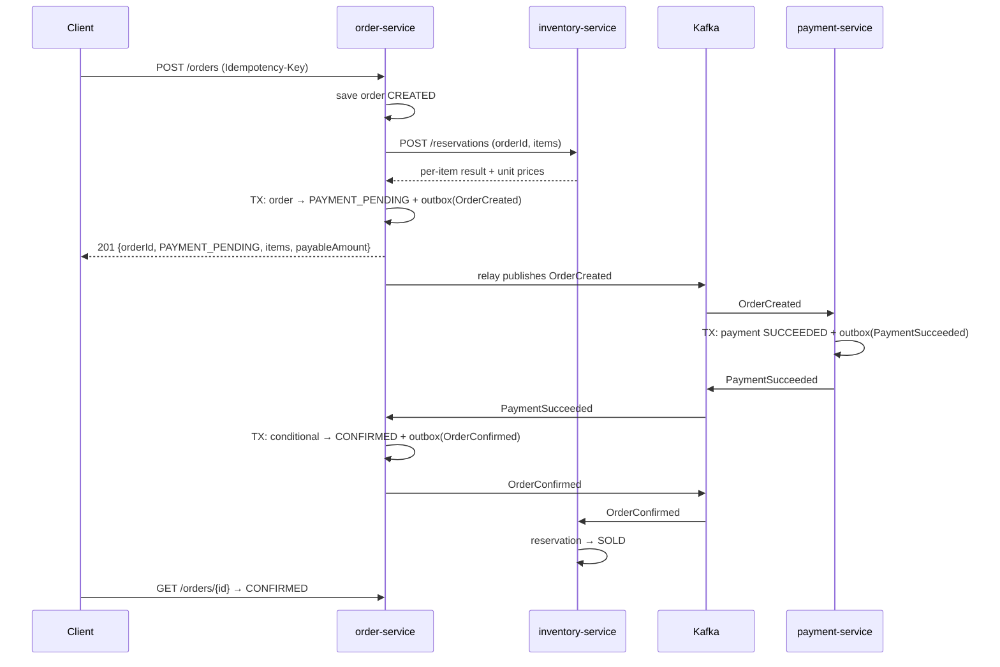

# 02 — High-Level Design (HLD)

> **Status:** v1.0 — Approved
> **Last updated:** 2026-10-21
> **Depends on:** [01 — Problem Statement](01-problem-statement.md)

---

## 1. Architecture overview



- **One entry point:** all client traffic goes through the API Gateway.
- **One synchronous call:** `order-service → inventory-service` to reserve stock.
- **Everything else is asynchronous** through Kafka.
- **Database per service:** each service owns its database. No service reads another service's tables.

---

## 2. Components

| Component | Tech | Responsibility |
|---|---|---|
| API Gateway | Spring Cloud Gateway | Routing; later JWT validation, rate limiting, request IDs |
| `order-service` | Spring Boot | Order API, state machine, idempotency, expiry job, outbox |
| `inventory-service` | Spring Boot | Product catalog, atomic reservations, reservation lifecycle |
| `payment-service` | Spring Boot | Mock payments, refunds |
| Postgres | Postgres 17 | One container hosting 3 separate databases (saves RAM locally) |
| Kafka | Kafka in KRaft mode (no ZooKeeper), single broker | Event backbone |

---

## 3. Communication

### 3.1 How we decide: synchronous or asynchronous

1. Does the caller **need the answer to continue**? → synchronous.
2. **Should the caller fail if the callee is down?** If not → asynchronous.
3. Is the work **slow or unpredictable**? → asynchronous.
4. Do **multiple services** care that it happened? → event.

### 3.2 Communication matrix

| From → To | Style | Why |
|---|---|---|
| Client → Gateway → services | REST | Client needs a response |
| order → inventory (reserve) | **REST (sync)** | `payableAmount` depends on what was reserved. We can't sell without checking stock. |
| order → payment | **Kafka** | The customer doesn't wait for payment. Orders are still accepted if payment is down. |
| payment → order | **Kafka** | Result arrives in the background |
| order → inventory (confirm / release) | **Kafka** | Nobody waits for it. Must happen eventually. |

---

## 4. Events

### 4.1 Rules

- An event is a **past-tense fact about data the publisher owns**.
- Find events by **walking the state machine**. Publish only if someone needs to know.
- **Partition key = `orderId`** for all events. All events of one order land on one partition, so they're **processed in order**.
  - A key of `orderId + something else` would split one order's events across partitions and break ordering.
  - A key of `productId` would put the whole flash sale on one **hot partition**.

### 4.2 Topics

| Topic | Publisher | Events | Key |
|---|---|---|---|
| `order-events` | order-service | `OrderCreated`, `OrderConfirmed`, `OrderCancelled` | `orderId` |
| `payment-events` | payment-service | `PaymentSucceeded`, `PaymentFailed` | `orderId` |
| `*.DLT` | (consumers' error handlers) | Messages that failed processing | original key |

### 4.3 Event catalogue

| Event | Publisher | Consumers | What the consumer does |
|---|---|---|---|
| `OrderCreated` | order | payment | Starts the mock payment |
| `PaymentSucceeded` | payment | order | Conditional update to `CONFIRMED`. If already `CANCELLED`, it's a late payment: no-op, because the refund is triggered by `OrderCancelled`. |
| `PaymentFailed` | payment | order | Conditional update to `CANCELLED` |
| `OrderConfirmed` | order | inventory | Marks the reservation **SOLD** |
| `OrderCancelled` | order | inventory, payment | **Inventory:** release stock. **Payment:** refund if a successful payment exists. |

### 4.4 Event envelope (common to all events)

```json
{
  "eventId": "uuid",
  "eventType": "OrderCreated",
  "eventVersion": 1,
  "orderId": "uuid",
  "occurredAt": "2026-10-21T10:00:00Z",
  "payload": { }
}
```

- `eventId` is used by consumers for **deduplication**.
- `eventVersion` allows the payload to evolve later without breaking consumers.

---

## 5. Key flows

### 5.1 Happy path



### 5.2 Failure paths

| Scenario | Flow |
|---|---|
| **All items out of stock** | Inventory reserves nothing → order `REJECTED` → `201` response with `REJECTED`. No events. |
| **Payment fails** | `PaymentFailed` → order `CANCELLED` → `OrderCancelled` → inventory releases stock |
| **Reservation expires** | Expiry job (in order-service) runs a conditional update → `CANCELLED` → `OrderCancelled` → inventory releases stock |
| **Customer cancels** | `POST /orders/{id}/cancel` runs a conditional update → `CANCELLED` → `OrderCancelled` → inventory releases stock |
| **Late payment** | Expiry wins the race → `CANCELLED`. `PaymentSucceeded` arrives → conditional update hits 0 rows → no-op. Payment-service, on `OrderCancelled`, finds a successful payment → **refund**. |

> Inventory **never releases stock on its own decision** in the normal flow. It only reacts to `OrderCancelled`. The single owner of the cancel decision is order-service.

---

## 6. Reliability patterns

### 6.1 Transactional Outbox (solves dual writes)

- **Problem:** Postgres and Kafka share no transaction. Save-then-publish can **lose events**. Publish-then-save can create **ghost events**, for example charging money for an order that doesn't exist.
- **Solution:** the business change and an `outbox` row are written in **one database transaction**. A **relay** (scheduled poller) publishes unsent rows to Kafka and marks them sent.
- **Consequence:** publishing is **at-least-once**, because the relay can crash after publishing and before marking the row sent. Consumers must therefore be idempotent (6.2).
- Used by **order-service** and **payment-service**, the services that publish events.

### 6.2 Idempotent consumers

- Kafka delivery is **at-least-once**. Duplicates come from consumer crashes before an offset commit, from rebalances, and from outbox re-publishing. **Offsets don't prevent duplicates. They cause them.**
- Every consumer is idempotent through **atomic** checks (never read-then-write):

| Consumer | Mechanism |
|---|---|
| order ← `PaymentSucceeded` / `PaymentFailed` | Conditional status update (`WHERE status = 'PAYMENT_PENDING'`) |
| payment ← `OrderCreated` | `payments.order_id UNIQUE`, so there's never a second charge |
| payment ← `OrderCancelled` | Refund only if payment is `SUCCEEDED`; conditional update `SUCCEEDED → REFUNDED` |
| inventory ← `OrderConfirmed` / `OrderCancelled` | Conditional reservation update (`WHERE status = 'RESERVED'`) |

### 6.3 Idempotent APIs

- `POST /orders`: `Idempotency-Key` header (see the Problem Statement, §7.2).
- `POST /reservations` (internal): keyed by `orderId`. A retried call after a timeout returns the **existing** reservation instead of reserving twice.

### 6.4 Error handling & dead-letter topics (DLT)

- **Transient errors** (database down, timeout): retry with **exponential backoff**, then send to the DLT.
- **Non-retryable errors** (invalid JSON, schema mismatch, validation failure): **straight to the DLT, no retries**. They fail the same way every time, so retrying only blocks the partition.
- Implemented with Spring Kafka `DefaultErrorHandler` + `DeadLetterPublishingRecoverer`.
- DLT messages are **logged and counted**. A message in the DLT is unfinished business, not something to ignore.
- Publisher-side validation reduces bad messages but **doesn't replace** consumer-side handling.

### 6.5 Timeouts on the synchronous call

- `order → inventory` has a **2-second timeout**. If it times out, `POST /orders` returns `503` and the order is left `CREATED`.
- A circuit breaker (Resilience4j) is added in Phase 2.

### 6.6 Stuck and orphan orders

- The order row is saved as `CREATED` **before** calling inventory. If order-service crashes mid-flow, the order still exists.
- The **expiry job** cancels orders stuck in `CREATED` or `PAYMENT_PENDING` longer than the expiry window. It publishes `OrderCancelled`, and inventory releases anything that was reserved.
- **Safety net:** inventory sweeps `RESERVED` reservations older than **30 minutes**, for cases where no event will ever arrive.

---

## 7. Failure modes

| Failure | Impact | Behaviour |
|---|---|---|
| inventory-service down | Can't place orders | `POST /orders` → `503` after the timeout. Existing orders are unaffected. |
| payment-service down | Payments delayed | Orders are still accepted. Events wait in Kafka and are processed on recovery. |
| Kafka down | Events delayed | Orders are still accepted. Events accumulate in the outbox and are published on recovery. |
| order-service crash mid-order | Partially processed order | The order exists as `CREATED`; the expiry job cleans up |
| Poison message | One message can't be processed | Goes to the DLT. The partition keeps flowing. |

> **Known limitation:** if payment-service or Kafka is down for **longer than the 5-minute expiry**, pending orders expire and are cancelled even though the customer never had a chance to pay. We accept this for Phase 1. A fix (for example, starting the expiry timer when payment *starts*) is a Phase 2 discussion.

---

## 8. Data ownership

| Service | Database | Tables |
|---|---|---|
| order-service | `orders_db` | `orders`, `order_items`, `idempotency_keys`, `outbox` |
| inventory-service | `inventory_db` | `products`, `inventory`, `reservations`, `processed_events` (if needed) |
| payment-service | `payments_db` | `payments`, `outbox` |

- Schema changes are managed with **Flyway** migrations (versioned SQL files). We never edit tables by hand.

---

## 9. Tech stack

| Area | Choice |
|---|---|
| Language | Java 21 (LTS) |
| Framework | Spring Boot (latest stable from start.spring.io) |
| Build | Maven |
| Persistence | Spring Data JPA + Postgres 17, Flyway migrations |
| Messaging | Spring Kafka, Kafka in KRaft mode |
| Gateway | Spring Cloud Gateway |
| Testing | JUnit 5, Mockito, Testcontainers (real Postgres and Kafka in tests) |
| API docs | springdoc-openapi (Swagger UI) |
| Local run | Docker Compose |

---

## 10. Repository layout

```
doms/
├── docs/                    # design docs (this file)
├── api-gateway/             # independent Maven project
├── order-service/           # independent Maven project
├── inventory-service/       # independent Maven project
├── payment-service/         # independent Maven project
├── infra/                   # docker-compose, Postgres init scripts
└── README.md
```

- **Monorepo with independent services.** Each service has its own `pom.xml` and builds and runs on its own, as it would in separate repositories. There's no shared code library in Phase 1. Event classes are duplicated per service, which avoids coupling services through a shared JAR.

---

## 11. Local deployment view

| Container | Port | Memory limit |
|---|---|---|
| api-gateway | 8080 | 384 MB |
| order-service | 8081 | 512 MB |
| inventory-service | 8082 | 512 MB |
| payment-service | 8083 | 384 MB |
| postgres | 5432 | 512 MB |
| kafka (KRaft) | 9092 | 1 GB |
| **Total** | | **≈ 3.3 GB** of 16 GB |

---

## 12. Decision log

| # | Decision | Rationale |
|---|---|---|
| H1 | Single synchronous call (order → inventory); everything else Kafka | Only stock reservation is needed for the response |
| H2 | API Gateway as the single entry point | One place for auth, rate limiting and routing, not obscurity |
| H3 | Two topics (`order-events`, `payment-events`), key = `orderId` | Per-order ordering, no hot partitions |
| H4 | Transactional Outbox with a polling relay | Solves dual writes. CDC (Debezium) later if needed. |
| H5 | All consumers idempotent through atomic checks | Delivery is at-least-once |
| H6 | Non-retryable errors go straight to the DLT | Poison messages must not block partitions |
| H7 | Order row saved `CREATED` before reservation | No order-less orphans; the expiry job can clean up |
| H8 | One Postgres container, 3 databases | Keeps "database per service" while saving local RAM |
| H9 | Monorepo, independent Maven projects, no shared library | Services stay independently buildable and deployable |

---

## 13. Evolution (Phase 2+)

- `auth-service` + JWT validation at the gateway
- `notification-service`, consuming **order** events (not payment events)
- Resilience4j circuit breaker on order → inventory
- Rate limiting at the gateway (Redis-backed) for flash sales
- Observability: Micrometer, Prometheus, Grafana, distributed tracing
- CDC (Debezium) instead of the polling outbox
